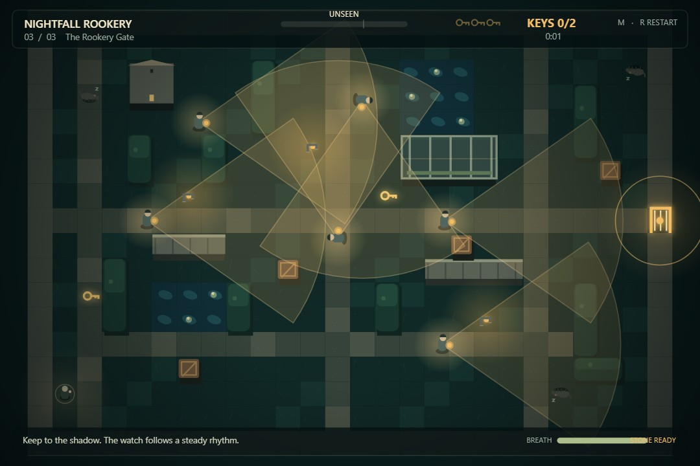
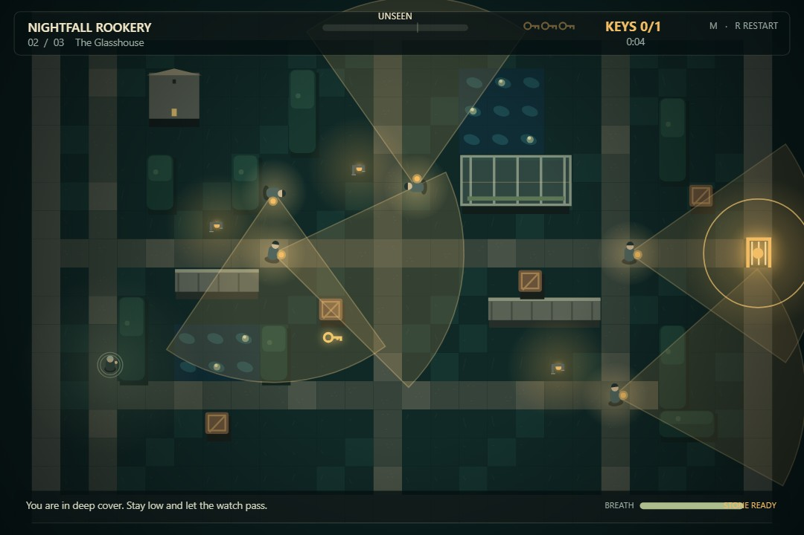
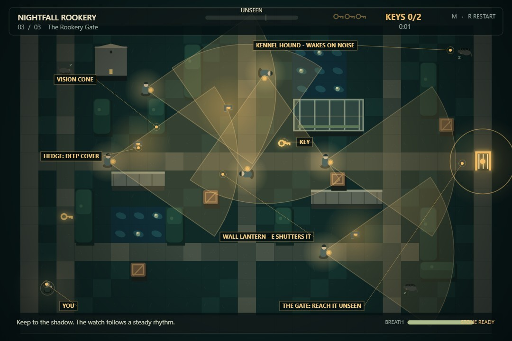
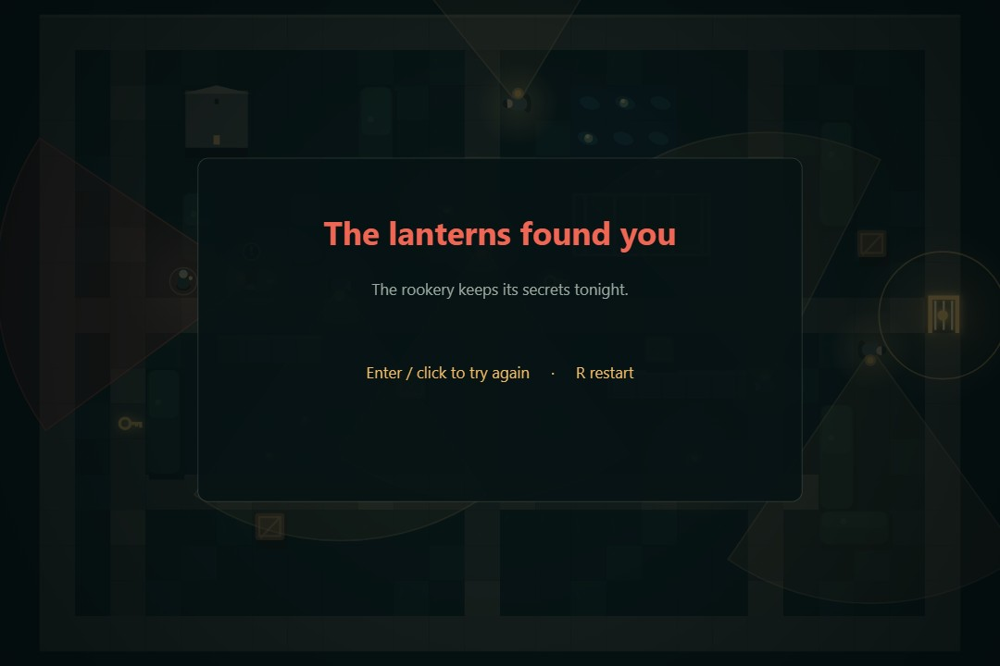

# Nightfall Rookery

A top-down stealth game about a small keeper, a walled night garden, four patrolling lamplighters, and one gate that has to be reached unseen. Built for make.fun's *Make the best stealth game* bounty.



You have no weapon. You have gravel underfoot, a breath you can hold, wall lanterns you can shutter, and a map of where the lamplighters walk. Every guard keeps a fixed round with a fixed pause; the only question is whether you have watched it long enough to walk through the gap.

[](https://make.fun/bounty/best-stealth-game-20261121-1759?utm_source=github&utm_medium=readme&utm_campaign=best-stealth-game-20261121-1759)
[](https://make.fun/bounty/best-stealth-game-20261121-1759/leaderboard?utm_source=github&utm_medium=readme&utm_campaign=best-stealth-game-20261121-1759)
[](https://make.fun/bounty/best-stealth-game-20261121-1759?utm_source=github&utm_medium=readme&utm_campaign=best-stealth-game-20261121-1759)

## Play it

```sh
node main.ts                  # writes the dossier and copies game/ and screenshots/ to /output
# or, to play in a browser:
npx serve game                # any static server works
```

Open `index.html`, press Enter, and pick a level with `1`, `2` or `3`.

| Key | What it does |
| --- | --- |
| `WASD` / arrows | walk |
| `Shift` (hold) | crouch: slower, quieter, harder to see |
| `Space` (hold) | sprint: fast, loud, and it drains your breath |
| `E` | shutter or open a wall lantern you are standing beside |
| mouse click | throw a stone to pull a lamplighter's attention away |
| `R` | restart the level |

## Three chapters

1. **The Gravel Walk** — four lamplighters, no keys, one gate. A quiet crossing that teaches the round.
2. **The Glasshouse** — five lamplighters, a brass key in the greenhouse, a longer patrol loop.
3. **The Rookery Gate** — six lamplighters, two keys, the tightest sight lines in the garden.

## How the stealth works

- **Vision cones.** Each lamplighter carries a cone that sweeps with its heading. The cone is checked against walls, hedges and benches, so a hedge is real cover, not decoration.
- **Suspicion, not instant failure.** Standing in a cone fills a suspicion meter. Break line of sight and it drains; let it fill and the lamplighter chases, and a chase that lasts ends the run. There is always a moment to recover, and the HUD tells you which state you are in.
- **Breath.** Sprinting is loud and burns breath; standing still refills it. Walking is free. Gravel scatters under a sprint and a lamplighter will turn toward the sound.
- **Stones.** A thrown stone lands where you click and pulls the nearest lamplighter's attention to it, which is how you move a patrol off a corridor you need.
- **Wall lanterns.** Each corridor is lit by iron lanterns. `E` shutters one: the corridor sinks into shadow, and a lamplighter standing in that shadow sees less than half as far. A lamplighter who passes a shuttered lantern relights it after a moment, so a dark corridor is a window, not a hiding place.
- **The kennel hound.** Levels two and three keep a hound asleep by its kennel. It never sees you: a sprint or a thrown stone within a few paces wakes it, and then it follows the trail of where you have been, barking, dragging the nearest lamplighters toward your scent. Stand still and it runs out of trail; crouch and it never wakes.

## The garden







## How it is built

Plain ES modules, no libraries, no build step, no network. `game/src` holds the whole game:

| Module | Responsibility |
| --- | --- |
| `main.js` | the loop, the run states, and the order the systems update in |
| `input.js` | keyboard and pointer intent, as one action word per frame |
| `player.js` | movement, crouch, sprint, breath, keys, stones |
| `guards.js` | patrol routes, pauses, suspicion, chase, relighting |
| `vision.js` | the line-of-sight test against the tile map |
| `lanterns.js` | which lantern is near, its shadow, and the guard's reduced sight in it |
| `hound.js` | the kennel hound: sleeping, waking on noise, following the keeper's scent trail |
| `world.js` | the tile map, collision and cover queries |
| `render.js` | the camera, the cones, the light pools, the silhouettes |
| `hud.js` | the suspicion meter, breath bar, key row and the hint line |
| `audio.js` | the small synthesised cues: gravel, a stone, a lamp, a chase |
| `levels.js` | the three levels: maps, patrol rounds, keys, lanterns |

Rendering is a canvas at a fixed 960x640 logical size, scaled to the window, drawn in one pass: floor, cover, light pools, cones, bodies, then HUD. There is no sprite sheet; every shape is drawn from the same palette, which is why the game is a few hundred kilobytes and loads instantly.

## Licence

MIT. See `LICENSE`.
